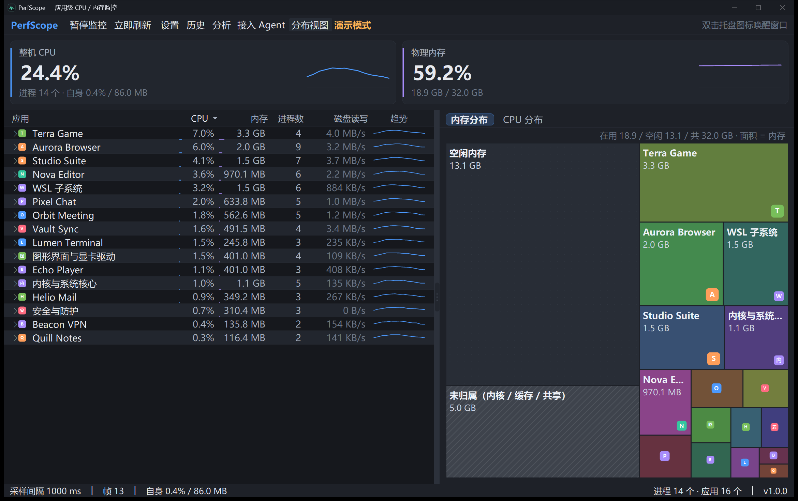

# PerfScope —— 常驻型 CPU / 内存监控（按`应用`看，不按进程看）

PerfScope 是一个 Windows 桌面小工具，目标很明确：

1. **能真的赖在后台一整年**：托盘常驻时自身 CPU 约 0.011~0.015%（整机口径，默认 2 秒采样、
   隐藏降频到 5 秒），工作集约 26~33 MB（私有内存 18 MB），句柄数稳定；主窗口打开时
   自身上升到约 0.07% CPU / 74~110 MB 工作集（自绘列表 + 双缓冲 + 图标缓存）；
2. **只回答"哪个应用占资源"**：把进程按版本信息 / 安装目录 / 目录树综合分析，挂钩到同一个应用上，
   Chrome 的 38 个进程、Brave 的 48 个进程在界面上就是一行；
3. **参数全部可调**：采样频率、归并策略、留存时长、界面刷新、告警阈值……都在设置页里改，改完热生效。

## 快速开始

    # 1) 构建（Debug）
    .\scripts\build.ps1

    # 2) 直接跑（Release 产物，托盘常驻）
    .\scripts\build.ps1 -Release
    .\scripts\run.ps1

    # 3) 发布单文件（dist\PerfScope.exe，依赖已安装的 .NET 10 桌面运行时）
    .\scripts\build.ps1 -Publish

    # 4) 跑测试
    .\scripts\run-tests.ps1

    # 5) 实测自身开销（启动 → 采集 60 秒 → 汇总 CPU / 内存 / 句柄 / 磁盘增长）
    .\scripts\measure.ps1 -Seconds 60

不开界面、只想看数据或排障时：

    # 采 4 帧、每 1.5 秒一帧、打印前 18 个应用
    .\tools\PerfScope.Cli\bin\Release\net10.0-windows\PerfScope.Cli.exe --frames 4 --interval 1500 --top 18

    # 只测原生采集耗时
    ... PerfScope.Cli.exe --bench --rounds 10

    # 接管道给别的工具
    ... PerfScope.Cli.exe --frames 3 --json

## 界面

- **托盘**：常驻图标，双击开主窗口；右键可暂停监控、打开设置、开关开机启动、退出。
- **主窗口**：顶部是两张指标卡（整机 CPU / 物理内存：标题、大数字、明细、固定 0~100 刻度的迷你趋势线）；
  中间左右分栏：左边是应用列表（应用名、CPU%、内存、进程数、磁盘读写、迷你趋势，点击一行可展开成员进程），
  右边是**分布视图**，顶部分段标签可切换「内存分布 / CPU 分布」，都是 Treemap（矩形树图，SpaceSniffer 用的同一类可视化）：
  内存分布覆盖物理内存（应用块 + 灰色斜纹「未归属（内核/驱动/缓存/共享页）」+ 点阵「空闲内存」），
  CPU 分布只画正在占用 CPU 的应用（面积 = 占用百分比）；应用图标画在方块右下角，鼠标悬停显示自绘卡片（实时刷新）；
  列表滚动条也是自绘的，跟随深色/浅色主题；
  两栏之间的分隔条可以拖动，比例会记住（工具栏「内存分布」可开关右栏）。
  底部状态栏分三段：采样参数 / **监控器自身开销** / 进程与应用数量。窗口标题栏、任务栏、托盘、exe 统一使用同一枚图标。
- **设置页**：覆盖全部参数，保存即生效。

关闭窗口默认最小化到托盘（可在设置里改成直接退出）。托盘常驻时采样自动降频到 5 秒一次。

## 设置项一览

| 分组 | 参数 | 默认 | 说明 |
|---|---|---|---|
| 采样 | 采样间隔 | 2000 ms | 500~10000；越大越省资源 |
| 采样 | 界面刷新间隔 | 1000 ms | 250~10000；只影响重绘，不影响采样 |
| 采样 | 隐藏时自适应降频 | 开 | 窗口不可见时改用隐藏间隔 |
| 采样 | 隐藏采样间隔 | 5000 ms | 1000~60000 |
| 采样 | 平滑窗口 | 3 帧 | 1 表示不平滑，用于压制毛刺 |
| 口径 | CPU 口径 | 整机百分比 | 或"单核百分比"（单线程跑满 = 100） |
| 口径 | 内存口径 | 工作集 | 或"私有提交" |
| 归并 | 按产品名归并 | 开 | 读 exe 版本信息，最能代表"一个应用" |
| 归并 | 按安装目录归并 | 开 | Program Files / LOCALAPPDATA\Programs / UWP / Steam 等 |
| 归并 | 子进程继承父进程 | 开 | 自身归属弱时沿用父进程 |
| 归并 | 合并 Windows 系统进程 | 开 | svchost 等合并为一行，避免刷屏 |
| 归并 | 自定义规则 | 空 | 合并到指定应用 / 只改名 / 排除 |
| 留存 | 内存保留 | 60 分钟 | 趋势曲线的内存缓冲 |
| 留存 | 磁盘保留 | 30 天 | 分钟级聚合，约 40 MB |
| 留存 | 趋势应用数 | 12 | 只跟踪 CPU 前 N 个应用，控制内存 |
| 界面 | 显示行数 | 30 | 5~200 |
| 界面 | 开机启动 | 关 | 写 HKCU\...\Run，不需要管理员 |
| 界面 | 关闭行为 | 最小化到托盘 | 或直接退出 |
| 界面 | 显示自身开销 | 开 | 状态栏显示自己的 CPU / 内存 |
| 界面 | 显示系统进程组 | 开 |                 |
| 告警 | 阈值告警 | 关 | CPU / 内存超阈值弹托盘气泡，带冷却 |

### 自定义规则示例

    # 把某个绿色软件的多个目录合并成一行
    匹配方式 PathContains  模式 D:\Tools\MyApp\  动作 合并到指定应用  目标 MyApp

    # 只改显示名
    匹配方式 ExeName  模式 wechat.exe  动作 重命名  目标 微信

    # 把不关心的后台程序从列表里去掉
    匹配方式 PathContains  模式 \AppData\Local\Temp\  动作 排除

## 归并是怎么做的

优先级（命中即停，界面上会把依据写在"归并依据"里，结果可解释）：

1. 用户自定义规则；
2. **系统功能模块**：把系统自己占的部分按功能拆开 —— WSL 子系统、虚拟机与容器、图形界面与显卡驱动、
   安全与防护、搜索与索引、系统更新、音频、打印、内核与系统核心；剩下的系统进程才进「Windows 系统」组
   （只按进程身份识别，不查服务、不需要管理员权限）；
3. Windows 系统进程聚合（System32 / SysWOW64 / WinSxS 等；但 explorer.exe 这类仍按普通应用处理）；
4. **exe 版本信息**（ProductName + CompanyName）——Chrome / Electron 类应用的多进程天然同源；
5. **安装根目录**（Program Files 的 Vendor\App、LOCALAPPDATA\Programs、WindowsApps 包族名、
   steamapps\common\Game，以及向上探测卸载器 / resources\app.asar 特征）；
6. exe 所在目录；
7. exe 文件名；
8. 兜底组。

解析结果全部进缓存（LRU + TTL），热路径上只是字典命中，不会每帧读盘。

## 数据与隐私

- 全部数据落在 %LOCALAPPDATA%\PerfScope：settings.json、history\（按天 32 字节定长记录）、logs\。
- **不联网、不收集、不上传**，没有第三方依赖（Core 与 App 只用 .NET 基础库 + WinForms + P/Invoke）。
- 磁盘占用：每分钟每个活跃应用一条 32 字节记录，默认保留 30 天约 40 MB；日志按大小轮转（默认上限 512 KB）。
- 权益：删掉 %LOCALAPPDATA%\PerfScope 即彻底清除。

## 已知限制

- 仅支持 Windows 10/11 x64（原生结构按 64 位布局）。
- 日志级别 / 日志大小上限的修改要**重启程序**才生效（ILog 没有热更新通道）。
- 极高进程数的机器（2000+ 进程）上，单次采样成本随进程数线性上升：默认 2 秒间隔仍然很轻，
  但如果你把间隔调到 500 ms，建议同时把"趋势应用数"调低。
- 磁盘历史只记录每帧 CPU 靠前的应用，冷门应用可能没有当日摘要。
- 归并是启发式的：同一软件如果存在两个独立安装目录，会显示为两个应用（名字会带区分后缀）。

## 目录结构

    PerfScope/
      src/PerfScope.Core/       采样、归并、历史、设置、日志（无 UI 依赖）
      src/PerfScope.App/        WinForms 托盘 + 主窗口 + 设置页
      tools/PerfScope.Cli/      命令行冒烟 / 性能实测 / JSON 输出
      tests/PerfScope.Tests/    单元测试（xunit）
      tests/PerfScope.TestRunner/  反射测试运行器（绕过本机跑不起来的 dotnet test）
      scripts/                  构建、运行、测试、实测、图标生成
      docs/                     架构、归并规则、验收报告

## 开发说明

- 启动 dev 版：`.\scripts\run-dev.ps1`（构建 → 镜像到 %LOCALAPPDATA%\PerfScope-dev → 启动）。
  之所以要先镜像到工作区外：本机的 Windows 沙箱按"进程映像所在路径"生效，exe 在工作区内时
  进程表会被过滤（实测 205 vs 930 个进程）、也写不了 %LOCALAPPDATA%，镜像出去才能拿到完整数据。

- 目标框架：.NET 10（net10.0-windows），SDK 由 global.json 固定为 10.0.402。
- 零第三方 NuGet 依赖（Core/App）；测试项目用 xunit。
- 本机 **dotnet test 不可用**（VSTest testhost 启动时需要打开父进程句柄，被环境拒绝），
  因此提供 PerfScope.TestRunner：直接反射执行同一批 [Fact]/[Theory]，用 .\scripts\run-tests.ps1 调用。
