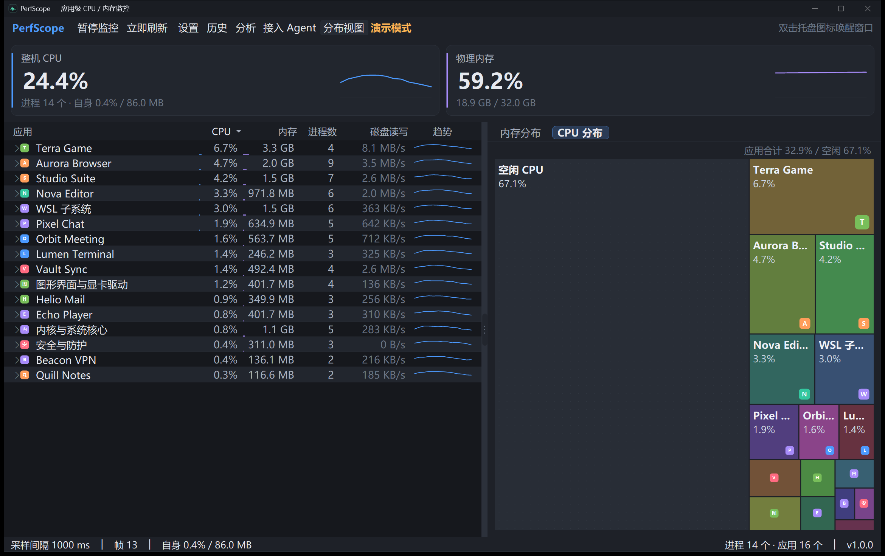
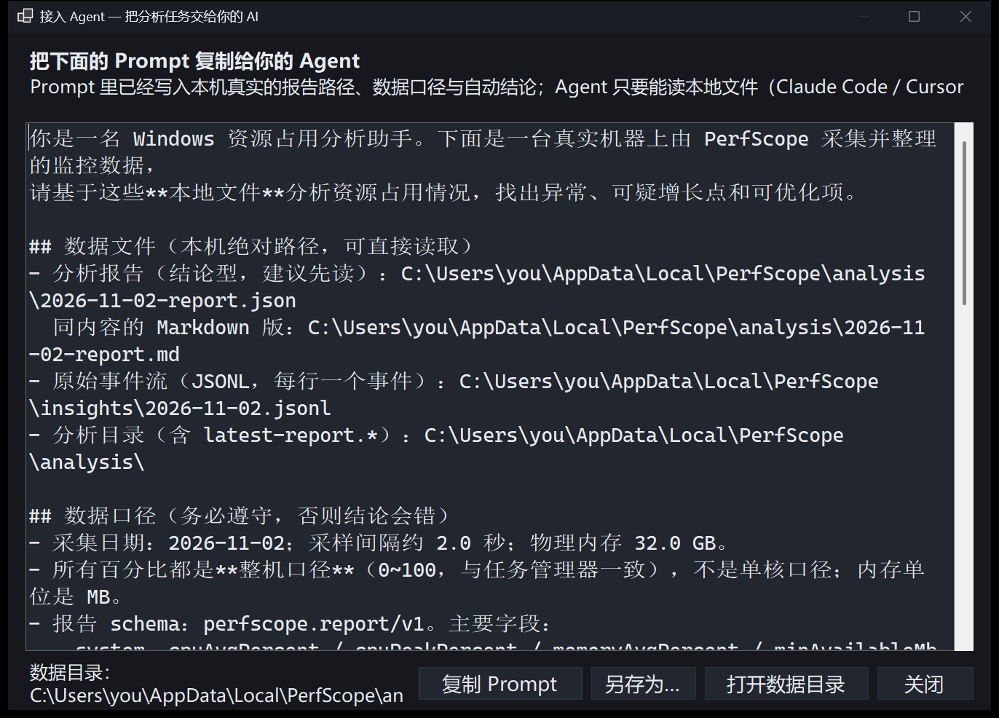

# PerfScope

**Application-level CPU & memory monitoring for Windows — quiet, precise, and ready to talk to your AI.**

  
  
  
  
  
  

## Introduction

Most task managers tell you *which process* is busy. PerfScope tells you **which application** is busy.

Individual processes are merged into the applications they belong to — browser renderers, Electron helpers, launchers and background workers all collapse into one honest row, together with the system features they represent, such as Windows Subsystem for Linux, the graphics stack, the kernel, or security services. What you see is a short list of applications you actually recognise, ranked by real usage.

**Highlights**

- **Application-level attribution** — hundreds of processes become a handful of apps, with the reason behind every grouping shown right in the UI.
- **Live distribution maps** — switch between *Memory* and *CPU* treemaps; block area is proportional to real usage, icons sit in the corner of each block, and a self-drawn hover card keeps the numbers current as you move.
- **Rich header trends** — the two headline cards unfold full axes, crosshair and a value tooltip on hover, so a glance becomes a measurement.
- **History that stays useful** — minute-level aggregation, noticeable episodes (CPU bursts, memory growth, system pressure) and a readable daily report, all kept on disk for the retention you choose.
- **Ready for your AI** — one click copies a fully prepared prompt that points your assistant at the local report, so analysis starts immediately instead of after an hour of context building.
- **Light on the machine** — a single sampling path, a compact memory footprint, and adaptive throttling while the window is hidden.

  
   
  Memory distribution — every block is an application, area is proportional to real usage.

  
   
  CPU distribution — see at a glance who owns the processor right now.

  
   
  Agent handoff — a ready-to-paste prompt with paths, definitions and preliminary findings.

## How to Use

PerfScope lives in the notification area and opens with a single click on the tray icon.

| Area | What you can do |
|---|---|
| **Header cards** | Live system CPU and physical memory, with trend curves. Hover a curve for axes, crosshair and the exact value at any moment. |
| **Application list** | Click any column to sort, expand an application to inspect its processes, and read the grouping reason in the tooltip. |
| **Distribution view** | Toggle *Memory* / *CPU* tabs, resize the splitter, or hide the panel entirely from the toolbar. |
| **Toolbar** | Pause monitoring, refresh immediately, open settings, browse history, generate the analysis report, or copy the Agent prompt. |
| **History** | Browse previous days, compare applications by CPU time, peak CPU and peak memory. |
| **Settings** | Sampling interval, smoothing, grouping rules, retention, theme, alerts, analysis thresholds — everything is adjustable and saved automatically. |

The window remembers its size, the splitter ratio and the active distribution tab, and a second launch simply brings the existing instance forward.

## Installation

**Requirements** — Windows 10 or Windows 11 (x64). No .NET runtime, no administrator rights.

Every tagged release publishes two flavours on the [Releases](https://github.com/Dynesshely/PerfScope/releases) page:

| Package | Best for |
|---|---|
| **PerfScope-Setup-x.y.z-win-x64.exe** | Regular use. Installs per-user into %LOCALAPPDATA%\Programs\PerfScope, adds a Start menu shortcut, registers a clean uninstaller. |
| **PerfScope-x.y.z-win-x64-portable.zip** | USB drives, locked-down machines, or simply trying it out — unzip and run PerfScope.exe. |

Each release also ships `SHA256SUMS.txt` so downloads can be verified:

~~~powershell
Get-FileHash .\PerfScope-Setup-1.0.0-win-x64.exe -Algorithm SHA256
~~~

Settings, history, logs and reports live in `%LOCALAPPDATA%\PerfScope`. To keep everything portable, start the app
with `PerfScope.exe --data-dir <folder>`.

## FAQ

### Why don't the numbers match Task Manager?

- **CPU** — both report a machine-wide percentage (0–100) by default, so the scale is the same. PerfScope samples
  every 2 s and averages over the last 3 frames, so very short spikes look lower than in Task Manager, which
  updates about once per second. If you prefer "one busy core = 100", switch *CPU basis* to *Per core (one
  saturated thread = 100)* in Settings — a fully loaded single thread then shows 100 and a 32-thread machine can
  show up to 3200.
- **Memory** — Task Manager's *Memory* column is the **active private working set** of a process, while PerfScope
  shows the total **working set** (shared pages included) and sums every process that belongs to the application.
  An application row therefore includes helpers, background workers and shared pages, which usually makes the
  number larger. Expand a row to inspect the per-process values. If you would rather compare against Task Manager,
  set *Memory basis* to *Private bytes (closer to actual usage)*.
- **Grouping** — one row is an application, not a PID. A browser row sums its browser, renderer, GPU, network and
  utility processes, so do not compare it with a single Task Manager row.

### Why can't I see some system processes?

- PerfScope lists **applications**, not processes. Windows components under `System32`/`SysWOW64` (including
  `svchost` and friends) are merged into the `Windows 系统` group or one of the feature modules — *WSL*,
  *Virtual machines & containers*, *Graphics & GPU drivers*, *Security*, *Search & indexing*, *Windows Update*,
  *Drivers & firmware*, *Kernel & system core*. Expand the row to see the member processes.
- **Protected processes** (PPL, such as some antivirus or DRM components) cannot be queried even as an
  administrator, so their executable path and version information are unavailable. They still appear, but only by
  image name, in a fallback group.
- `Idle` (PID 0) and `System` (PID 4) have no executable path; they are grouped into *Kernel & system core*.
- Check *Settings → Grouping → Custom rules*: a rule can exclude processes on purpose, and excluded processes are
  then hidden from the list and from statistics.

### Why does WSL use so much memory?

WSL2 runs a lightweight virtual machine, and Windows reports the memory of that VM as the `vmmemWSL` working set.
Linux uses free memory for page cache and does not hand it back immediately, so the number can be surprisingly
large even when nothing is running inside WSL. PerfScope attributes `vmmemWSL`, `wslhost`, `wslservice` and
similar processes to the *WSL subsystem* row. Run `wsl --shutdown` to release the memory, or cap it in
`%USERPROFILE%\.wslconfig` (`[wsl2]` → `memory=4GB`). Docker Desktop and Hyper-V virtual machines behave the
same way and are grouped into *Virtual machines & containers*.

### Where is my data stored, and how do I delete it?

Settings, history, logs and reports live in `%LOCALAPPDATA%\PerfScope`:

| Path | Contents |
| --- | --- |
| `settings.json` | every setting from the Settings page (plain JSON, safe to edit while the app is closed) |
| `history\` | one binary file per day plus `apps.json` (application id/name table) |
| `logs\` | rotating `perfscope.log` and `crash.log` (crash reports only) |
| `analysis\` | generated Markdown/JSON reports |
| `insights\` | short JSONL summaries of noticeable episodes |

To reset everything, quit PerfScope (including the tray icon) and delete that folder. The uninstaller asks whether
to delete it as well. To keep data elsewhere, start the app with `PerfScope.exe --data-dir D:\PerfScopeData` or
set the `PERFSCOPE_DATA_DIR` environment variable. History is pruned automatically after the retention period from
Settings (default 30 days); setting *On-disk retention (days)* to 0 disables disk history entirely.

## Data & Privacy

**PerfScope is fully offline.** It performs no network I/O at all: there is no HTTP client, no socket, no
telemetry, no analytics, no crash uploading and no update check. Nothing about you, your machine, your applications
or your usage ever leaves the computer. The source code is public, so you can audit it — and an outbound firewall
rule will show no connections.

What the app does:

- reads process metadata through `NtQuerySystemInformation` (process ids, CPU times, working set, executable
  paths) and resolves version information from the executables on disk — read-only, no elevation required;
- never reads your documents, browser history, keystrokes, window titles or network traffic;
- writes only inside its data directory (see the table above), plus an optional Start menu shortcut created by the
  installer;
- copies the Agent prompt to the clipboard only when you click that button — what happens next is up to the
  assistant you paste it into.

Data is stored in plain files: JSON for settings, Markdown/JSON for reports and a compact binary format for
history. There are no accounts, no cloud sync and no remote configuration. See *Where is my data stored* above for
paths and removal; security issues are handled in [SECURITY.md](SECURITY.md).

## How to Dev

Prerequisites: [.NET 10 SDK](https://dotnet.microsoft.com/download) and Windows.

~~~powershell
git clone https://github.com/Dynesshely/PerfScope.git
cd PerfScope

dotnet build -c Debug                    # build everything
dotnet run --project src/PerfScope.App   # run the app

.\scripts\run-tests.ps1                  # run the test suite
.\scripts\build.ps1 -Publish             # produce dist\PerfScope.exe
~~~

**Mock mode** — the UI can run on entirely synthetic data, which is how the screenshots above are produced and a convenient way to work on layout without any real workload:

~~~powershell
dotnet run --project src/PerfScope.App -- --mock
.\scripts\mock-screenshots.ps1           # regenerate docs/images from mock data
~~~

**Releases** are produced entirely by CI: push a semver tag and the workflow builds, tests, packages and
publishes both artefacts to GitHub Releases.

~~~powershell
git tag v1.0.0
git push origin v1.0.0
~~~

To build the same artefacts locally:

~~~powershell
.\scripts\package.ps1 -Version 1.0.0   # dist\release: portable zip + NSIS installer + SHA256SUMS
~~~

Before sending a pull request, read [CONTRIBUTING.md](CONTRIBUTING.md) for the development, testing and commit
conventions; project-internal rules and the release checklist live in [AGENTS.md](AGENTS.md). Release notes are
kept in [CHANGELOG.md](CHANGELOG.md), and security issues are handled through [SECURITY.md](SECURITY.md).

## Structure

~~~text
PerfScope/
├─ src/
│  ├─ PerfScope.Core/        # sampling, application grouping, history, insights, settings
│  └─ PerfScope.App/         # WinForms shell: main window, controls, forms, theming
├─ tools/
│  └─ PerfScope.Cli/         # headless helper: frames, JSON output, reports, benchmarks
├─ tests/
│  ├─ PerfScope.Tests/       # xUnit test suite
│  └─ PerfScope.TestRunner/  # lightweight console runner used in this repository
├─ scripts/                  # build, test, screenshot and measurement helpers
├─ docs/                     # logo and documentation images
└─ artifacts/                # local build output and captured runs (not tracked)
~~~

## Star History

<a href="https://star-history.com/#Dynesshely/PerfScope&Date">
  <picture>
    <source media="(prefers-color-scheme: dark)" srcset="https://api.star-history.com/svg?repos=Dynesshely/PerfScope&type=Date&theme=dark" />
    
  </picture>
</a>

## LICENSE

Released under the [MIT License](LICENSE).

Copyright (c) 2026 Dynesshely.